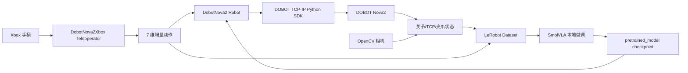

# dwlerobot

#### 介绍
文件夹点击后有具体的开发文档介绍

# LeRobot + Xbox + SmolVLA + DOBOT Nova2 开发文档

## 1. 文档范围

本文记录在 LeRobot 框架内接入 DOBOT Nova2 机械臂，并使用 Xbox 手柄采集遥操作数据、基于本地 SmolVLA 进行微调、最后在 Nova2 上闭环执行时遇到的问题与解决办法。

项目主线如下：

1. 将 Nova2 封装成 LeRobot 第三方 `Robot` 插件。
2. 将 Xbox 手柄封装成 LeRobot 第三方 `Teleoperator` 插件。
3. 使用手柄采集 Nova2 的视觉、状态、动作数据集。
4. 使用本地 SmolVLA / SmolVLM 权重进行微调。
5. 使用微调 checkpoint 回到真实 Nova2 上做策略推理。

本文以当前本机开发路径为例：

```text
D:\EVAN\CODEX
E:\jushenzhineng\lerobot
E:\jushenzhineng\lerobot\lerobot_robot_dobot_nova2
E:\jushenzhineng\lerobot\models\smolvla_base_nova2
E:\jushenzhineng\lerobot\models\smolvla_base_nova2_migrated
E:\jushenzhineng\DOBOT\TCP-IP-Python-V4-main\TCP-IP-Python-V4-main
```

## 2. 系统架构



核心接口约定：

```text
observation.state: 13 维
joint_1.pos ... joint_6.pos
tcp.x, tcp.y, tcp.z, tcp.rx, tcp.ry, tcp.rz
gripper.pos

action: 7 维
delta_x, delta_y, delta_z, delta_rx, delta_ry, delta_rz, gripper
```

采用 TCP 小步增量动作，而不是直接输出绝对位姿。这样做的好处是遥操作、数据集、模型推理统一在同一个动作空间里，并且可以在 `send_action()` 内部做单步限幅，降低真实机械臂突然大幅运动的风险。

## 3. 关键实现文件

```text
E:\jushenzhineng\lerobot\lerobot_robot_dobot_nova2\src\lerobot_robot_dobot_nova2\config_dobot_nova2.py
E:\jushenzhineng\lerobot\lerobot_robot_dobot_nova2\src\lerobot_robot_dobot_nova2\dobot_nova2.py
E:\jushenzhineng\lerobot\lerobot_robot_dobot_nova2\src\lerobot_robot_dobot_nova2\dobot_sdk_adapter.py
E:\jushenzhineng\lerobot\lerobot_robot_dobot_nova2\src\lerobot_robot_dobot_nova2\xbox_teleop.py
E:\jushenzhineng\lerobot\lerobot_robot_dobot_nova2\src\lerobot_robot_dobot_nova2\xbox_debug.py
E:\jushenzhineng\lerobot\src\lerobot\scripts\lerobot_record.py
E:\jushenzhineng\lerobot\src\lerobot\scripts\lerobot_teleoperate.py
E:\jushenzhineng\lerobot\src\lerobot\common\train_utils.py
E:\jushenzhineng\lerobot\src\lerobot\policies\pretrained.py
D:\EVAN\CODEX\make_gripper_state_action_dataset.py
```

## 4. 环境安装与验证

建议在 LeRobot 环境中安装主仓库和 Nova2 插件：

```powershell
cd E:\jushenzhineng\lerobot
conda activate lerobot
python -m pip install -e .
python -m pip install -e .\lerobot_robot_dobot_nova2
```

离线测试：

```powershell
cd E:\jushenzhineng\lerobot\lerobot_robot_dobot_nova2
python -m pytest tests
```

手柄轴位诊断：

```powershell
cd E:\jushenzhineng\lerobot
python -m lerobot_robot_dobot_nova2.xbox_debug
```

机械臂联机前需要确认：

```text
Nova2 控制器 IP: 192.168.5.1
Dashboard 端口: 29999
电脑网卡与机械臂在同一网段
DobotStudio 没有持续占用控制权
急停按钮可触达
第一次测试 speed_factor=5，max_xyz_step_mm=1，max_rot_step_deg=0.5
```

## 5. 遥操作与数据采集命令

只遥操、不保存数据：

```powershell
cd E:\jushenzhineng\lerobot
python -m lerobot.scripts.lerobot_teleoperate `
  --robot.type=dobot_nova2 `
  --robot.host=192.168.5.1 `
  --robot.enable_gripper=true `
  --robot.gripper_action_threshold=0.5 `
  --robot.control_mode=servop `
  --robot.speed_factor=70 `
  --robot.max_xyz_step_mm=24 `
  --robot.max_rot_step_deg=8 `
  --teleop.type=dobot_nova2_xbox `
  --teleop.control_style=smooth `
  --teleop.xyz_step=8 `
  --teleop.rot_step=3 `
  --teleop.deadzone=0.12 `
  --teleop.axis_curve=1.6 `
  --teleop.min_output=0.15 `
  --teleop.smoothing=0.35 `
  --teleop.stop_smoothing=0.65 `
  --teleop.turbo_threshold=0.85 `
  --teleop.turbo_multiplier=1.5 `
  --teleop.calibration_dir=E:\jushenzhineng\lerobot\.calibration `
  --fps=50
```

采集单相机数据：

```powershell
python -m lerobot.scripts.lerobot_record `
  --robot.type=dobot_nova2 `
  --robot.host=192.168.5.1 `
  --robot.enable_gripper=true `
  --robot.control_mode=servop `
  --robot.speed_factor=70 `
  --robot.max_xyz_step_mm=6 `
  --robot.max_rot_step_deg=2 `
  --robot.cameras="{front: {type: opencv, index_or_path: 0, width: 640, height: 480, fps: 30, backend: DSHOW, fourcc: 'MJPG'}}" `
  --teleop.type=dobot_nova2_xbox `
  --teleop.control_style=smooth `
  --teleop.xyz_step=6 `
  --teleop.rot_step=2 `
  --teleop.deadzone=0.12 `
  --teleop.axis_curve=1.6 `
  --teleop.min_output=0.15 `
  --teleop.smoothing=0.35 `
  --teleop.stop_smoothing=0.65 `
  --teleop.turbo_threshold=0.85 `
  --teleop.turbo_multiplier=1.5 `
  --teleop.calibration_dir=E:\jushenzhineng\lerobot\.calibration `
  --dataset.repo_id=local/nova2_xbox_opencv_30fps_640x480 `
  --dataset.single_task="grasp the orange cube into the black box" `
  --dataset.root=E:\jushenzhineng\lerobot\datasets\nova2_xbox_opencv_30fps_640x480 `
  --dataset.num_episodes=50 `
  --dataset.episode_time_s=60 `
  --dataset.reset_time_s=5 `
  --dataset.fps=30 `
  --dataset.push_to_hub=false `
  --dataset.video=true `
  --dataset.vcodec=auto `
  --dataset.video_crf=5 `
  --dataset.streaming_encoding=true `
  --dataset.encoder_threads=1 `
  --display_data=false
```

当前已有数据集示例：

```text
nova2_xbox_opencv_30fps_640x480: 45 episodes, 44937 frames, front 相机
nova2_xbox_smooth_30fps_640x480no50_crf20: 50 episodes, 45924 frames, side/up 双相机
```

## 6. SmolVLA 本地微调

本地模型目录：

```text
E:\jushenzhineng\lerobot\models\smolvla_base_nova2
E:\jushenzhineng\lerobot\models\smolvla_base_nova2_migrated
E:\jushenzhineng\lerobot\models\SmolVLM2-500M-Video-Instruct
```

旧式 SmolVLA checkpoint 如果带有内置 normalization，需要先迁移到 LeRobot 新的 processor pipeline：

```powershell
cd E:\jushenzhineng\lerobot
python -m lerobot.processor.migrate_policy_normalization `
  --pretrained-path E:\jushenzhineng\lerobot\models\smolvla_base_nova2 `
  --output-dir E:\jushenzhineng\lerobot\models\smolvla_base_nova2_migrated
```

训练单相机策略示例：

```powershell
D:\Anaconda\envs\lerobot\python.exe -m lerobot.scripts.lerobot_train `
  --dataset.repo_id=local/nova2_xbox_opencv_30fps_640x480 `
  --dataset.root=E:\jushenzhineng\lerobot\datasets\nova2_xbox_opencv_30fps_640x480 `
  --policy.type=smolvla `
  --policy.pretrained_path=E:\jushenzhineng\lerobot\models\smolvla_base `
  --policy.vlm_model_name=E:\jushenzhineng\lerobot\models\SmolVLM2-500M-Video-Instruct `
  --policy.repo_id=local/nova2_smolvla_opencv_front `
  --policy.push_to_hub=false `
  --policy.device=cuda `
  --policy.n_action_steps=10 `
  --policy.chunk_size=50 `
  --output_dir=E:\jushenzhineng\lerobot\outputs\train\nova2_smolvla_opencv_front `
  --job_name=nova2_smolvla_opencv_front `
  --batch_size=2 `
  --steps=20000 `
  --save_freq=10000 `
  --log_freq=100 `
  --eval_freq=10000 `
  --wandb.enable=false
```

训练双相机策略示例：

```powershell
lerobot-train `
  --dataset.repo_id=local/nova2_xbox_smooth_30fps_640x480no50 `
  --dataset.root=E:\jushenzhineng\lerobot\datasets\nova2_xbox_smooth_30fps_640x480no50 `
  --policy.type=smolvla `
  --policy.pretrained_path=E:\jushenzhineng\lerobot\models\smolvla_base_nova2_migrated `
  --policy.n_action_steps=50 `
  --policy.chunk_size=50 `
  --batch_size=2 `
  --steps=20000 `
  --save_freq=20000 `
  --output_dir=E:\jushenzhineng\lerobot\outputs\train\nova2_smolvla_v4 `
  --wandb.enable=false
```

当前可用 checkpoint 示例：

```text
E:\jushenzhineng\lerobot\outputs\train\nova2_smolvla_opencv_front\checkpoints\010000\pretrained_model
E:\jushenzhineng\lerobot\outputs\train\nova2_smolvla_v4\checkpoints\020000\pretrained_model
```

## 7. 问题与解决办法

### 7.1 LeRobot 无法识别 Nova2 机器人类型

现象：

```text
--robot.type=dobot_nova2 或 --teleop.type=dobot_nova2_xbox 无法解析
```

原因：

Nova2 是自定义第三方硬件，必须通过 `RobotConfig.register_subclass()` 和 `TeleoperatorConfig.register_subclass()` 注册，同时插件包需要被当前 Python 环境安装。

解决：

1. 在 `config_dobot_nova2.py` 中注册：

```python
@RobotConfig.register_subclass("dobot_nova2")
@TeleoperatorConfig.register_subclass("dobot_nova2_xbox")
```

2. 安装插件：

```powershell
python -m pip install -e E:\jushenzhineng\lerobot\lerobot_robot_dobot_nova2
```

3. 保证 `__init__.py` 导出 `DobotNova2`、`DobotNova2Xbox` 等类。

### 7.2 DOBOT 官方 SDK 路径和版本不一致

现象：

```text
找不到 dobot_api.py
Dashboard 缺少 MovL / MovJ / ServoP
```

原因：

DOBOT TCP-IP Python SDK 目录有外层和内层目录，`sdk_path` 必须指向包含 `dobot_api.py` 的内层目录。同时 V3/V4 SDK 的接口位置和行为有差异。

解决：

在 `dobot_sdk_adapter.py` 中通过 `importlib.util.spec_from_file_location()` 动态加载本地 SDK，并在连接时检查 Dashboard 是否具备 `MovL`、`MovJ`、`ServoP` 方法。当前默认路径为：

```text
E:\jushenzhineng\DOBOT\TCP-IP-Python-V4-main\TCP-IP-Python-V4-main
```

如 SDK 位置改变，用 CLI 覆盖：

```powershell
--robot.sdk_path=E:\path\to\TCP-IP-Python-V4-main\TCP-IP-Python-V4-main
```

### 7.3 Nova2 连接超时或上电后不能运动

现象：

```text
无法连接 192.168.5.1:29999
指令返回 ErrorID
机器人已连接但不执行动作
```

原因：

常见原因包括电脑和机械臂不在同一网段、DobotStudio 占用控制权、机器人未上电、未清错、未使能。

解决：

在 `startup_on_connect=true` 时执行：

```text
RequestControl -> ClearError -> PowerOn -> 等待上电 -> EnableRobot -> SpeedFactor
```

其中 `startup_power_on_wait_s` 默认留出等待时间，避免 `PowerOn()` 后立刻 `EnableRobot()` 导致控制器状态未就绪。

### 7.4 录制时观测线程和运动线程争用 TCP socket

现象：

```text
get_observation 和 send_action 偶发卡住
Dashboard 返回串包或解析错误
```

原因：

DOBOT Dashboard TCP 是同步收发接口，如果录制主循环读状态、遥操线程发动作同时访问同一个 Dashboard 连接，就可能发生读写交叉。

解决：

在 `DobotNova2` 内部加入 `threading.RLock()`，所有 SDK 状态读取和运动发送都通过同一把锁串行化：

```text
get_joints / get_pose / move_delta / movej_joints / set_gripper_percent
```

后续如果需要更高频控制，建议拆分 Dashboard 状态连接和运动连接，或做单独动作队列，不要让多个线程直接操作同一个同步 socket。

### 7.5 Xbox 手柄轴位在 Windows 上不稳定

现象：

```text
左摇杆方向反了
LT/RT 不触发夹爪
方向键读不到 Rz
不同手柄 axis/button 编号不同
```

原因：

pygame 在不同手柄、驱动、蓝牙/有线模式下暴露的 axis/button 编号可能不同。LT/RT 通常是 `[-1, 1]` 连续轴，不是普通按钮。

解决：

先运行：

```powershell
python -m lerobot_robot_dobot_nova2.xbox_debug
```

观察 `axes`、`buttons`、`hats` 变化，再调整：

```text
left_x_axis, left_y_axis, right_x_axis, right_y_axis
lt_axis, rt_axis
lb_button, rb_button, a_button, b_button, x_button, y_button
invert_left_x, invert_left_y, invert_right_x, invert_right_y
```

当前默认映射：

```text
左摇杆 X/Y: 平移 X/Y
右摇杆 Y: Z
方向键左右: Rz
LB/RB: Ry
LT/RT: 夹爪关/开
Y: 回初始位
A: 成功结束当前 episode
X: 重录当前 episode
B: 停止录制
```

### 7.6 手柄动作抖动，机械臂小幅来回晃

现象：

```text
手柄回中后仍有微小动作
低速遥操不够顺滑
轻推摇杆输出太小，重推又太猛
```

原因：

真实手柄摇杆存在零点漂移。直接把原始 axis 线性映射到机械臂增量，会导致死区外的微小噪声也变成运动指令。

解决：

在 `DobotNova2Xbox` 中增加：

```text
deadzone: 零点死区
axis_curve: 非线性曲线
smoothing / stop_smoothing: 平滑滤波
min_output: 最小有效输出
turbo_threshold / turbo_multiplier: 大推杆加速
trigger_threshold: LT/RT 夹爪触发阈值
```

同时在 Robot 端再次用 `clamp_delta_action()` 限幅：

```text
max_xyz_step_mm=1
max_rot_step_deg=0.5
gripper 限制到 [-1, 1]
```

这样即使策略或手柄输出异常，也会先被 Robot 层裁剪。

### 7.7 `teleop_control_fps` 异步遥操不稳定

现象：

```text
开启 teleop_control_fps 后，录制帧和控制帧节奏不一致
机械臂动作更顺但数据中的 action/observation 对齐变差
偶发控制线程异常导致 episode 提前结束
```

原因：

异步控制线程会让动作发送频率高于数据采集频率，但真实机器人状态、相机帧、保存到数据集的 action 未必严格对应同一时刻。对 imitation learning 来说，这会引入时间对齐噪声。

解决：

当前在 `lerobot_record.py` 中将 `async_teleop_enabled` 关闭，并在用户传入 `teleop_control_fps > 0` 时打印警告，优先使用同步录制路径，保证数据帧与动作一致。

后续如果要恢复异步控制，需要同时记录：

```text
动作发送时间戳
观测采集时间戳
实际发送到机器人后的 clipped action
```

并在数据集写入阶段做时间对齐。

### 7.8 手柄按键事件没有被 LeRobot 主循环消费

现象：

```text
Y 键无法让机器人回初始位
A/X/B 对 episode 成功、重录、停止录制的控制不生效
```

原因：

LeRobot 原生遥操主循环主要处理标准 `TeleopEvents`，第三方 Teleoperator 返回的自定义事件如 `home_position`、`stop_recording` 没有被统一消费。

解决：

在 `lerobot_teleoperate.py` 和 `lerobot_record.py` 中增加事件读取：

```text
get_teleop_events()
home_position -> robot.move_to_initial_position()
SUCCESS -> 结束并保留 episode
RERECORD_EPISODE -> 重录
stop_recording -> 停止整个录制
```

同时在 `DobotNova2` 中实现：

```text
move_to_initial_position()
```

当前初始关节位：

```text
[70.0, 30.0, 90.0, -30.0, -90.0, -10.0]
```

### 7.9 夹爪初始化和寄存器控制不稳定

现象：

```text
夹爪无响应
ModbusCreate 没有返回 index
写开口值后夹爪不动作
不同固件下是否需要写 execute 寄存器表现不一致
```

原因：

Nova2 末端 485 夹爪需要先配置 `SetTool485(115200,"N",1)`，再通过 `ModbusCreate()` 建立 RTU 通道。夹爪寄存器还区分宽度、力度、位置反馈和执行寄存器。

解决：

初始化流程：

```text
ModbusClose(0..4)
SetTool485(115200,"N",1)
ModbusCreate(127.0.0.1,60000,1,1)
SetHoldRegs(force_addr=40001)
可选 find travel / execute
```

关键寄存器：

```text
gripper_width_addr: 40000
gripper_position_addr: 40005
gripper_execute_addr: 40008
gripper_force_percent: 50
gripper_max_width: 100
```

配置项 `gripper_execute_after_width` 用来兼容不同固件：

```text
false: 只写力度和开口，贴近 Smartagent/QML 工程行为
true: 写开口后再写 execute=1，然后复位 execute=0
```

### 7.10 策略输出夹爪连续值，但真实夹爪需要离散开/合

现象：

```text
SmolVLA 输出 gripper 小幅连续值
夹爪被噪声频繁触发
抓取时没有稳定闭合
```

原因：

模型输出是连续动作，真实夹爪更接近二值状态。训练数据中如果只在按下 LT/RT 的瞬间有动作，模型很难学到“抓住以后保持闭合”的状态。

解决：

Robot 端使用阈值：

```text
abs(gripper) < gripper_action_threshold -> 0
gripper > threshold -> 打开
gripper < -threshold -> 闭合
```

数据集侧可以用 `make_gripper_state_action_dataset.py` 根据 `observation.state` 中的 `gripper.pos` 重新标注夹爪动作，把瞬时开合改成持续状态标签：

```powershell
python D:\EVAN\CODEX\make_gripper_state_action_dataset.py `
  --src E:\jushenzhineng\lerobot\datasets\nova2_xbox_opencv_30fps_640x480 `
  --dst E:\jushenzhineng\lerobot\datasets\nova2_xbox_opencv_30fps_640x480_gripper_state `
  --closed-threshold 10 `
  --open-threshold 90 `
  --closed-action -1 `
  --open-action 1 `
  --mid-action 0
```

### 7.11 Windows 下 checkpoint 的 `last` 符号链接创建失败

现象：

```text
训练保存 checkpoint 时创建 checkpoints/last 失败
OSError: symbolic link privilege not held
```

原因：

Windows 普通权限通常不能创建 symlink，LeRobot 默认使用 `last -> 020000` 这类符号链接。

解决：

在 `src\lerobot\common\train_utils.py` 中修改 `update_last_checkpoint()`：

```text
优先创建 symlink
如果 OSError，则退回 shutil.copytree(checkpoint_dir, last_checkpoint_dir)
如果 last 已经是普通目录，则先 shutil.rmtree()
```

这样训练不会因为 Windows 权限中断，代价是 `last` 会占用一份额外磁盘空间。

### 7.12 Windows 本地模型路径被当成 Hugging Face repo id

现象：

```text
policy.path=E:\jushenzhineng\lerobot\models\...
加载时被当成远程 repo id
路径里的反斜杠导致校验失败
```

原因：

部分 LeRobot / Hugging Face 加载逻辑会把字符串统一当成 repo id 处理。Windows 绝对路径包含 `\` 和盘符，容易触发 repo id 校验。

解决：

在 `src\lerobot\policies\pretrained.py` 中保留本地目录判断：

```python
model_id = str(pretrained_name_or_path)
if not os.path.isdir(model_id):
    model_id = model_id.replace("\\", "/")
if os.path.isdir(model_id):
    # local directory
else:
    # Hugging Face Hub
```

重点是只在“不是本地目录”时替换反斜杠，避免把真实 Windows 路径改坏。

### 7.13 SmolVLA normalization 版本不匹配

现象：

```text
加载旧 checkpoint 时缺少 policy_preprocessor.json / policy_postprocessor.json
state_dict 中出现 normalize_inputs、unnormalize_outputs 等旧字段
推理时 action 尺度不对
```

原因：

LeRobot 新版本将 normalization 从模型内部迁移到 processor pipeline。如果直接用旧 checkpoint，预处理/后处理链路不完整。

解决：

使用：

```powershell
python -m lerobot.processor.migrate_policy_normalization `
  --pretrained-path E:\jushenzhineng\lerobot\models\smolvla_base_nova2 `
  --output-dir E:\jushenzhineng\lerobot\models\smolvla_base_nova2_migrated
```

迁移后目录应包含：

```text
config.json
model.safetensors
policy_preprocessor.json
policy_postprocessor.json
README.md
```

训练和推理时优先使用 migrated 目录。

### 7.14 模型配置的相机字段必须和数据集一致

现象：

```text
训练或推理时报 observation.images.front / side / up 缺失
视觉输入 shape 不匹配
```

原因：

SmolVLA 的 `input_features` 是从数据集元数据和 policy config 推导出来的。单相机数据集和双相机数据集不能直接混用同一个视觉字段配置。

解决：

保持三处一致：

```text
Robot cameras 配置
Dataset meta/info.json 的 observation.images.*
Policy config.json 的 input_features
```

当前示例：

```text
单相机: observation.images.front
双相机: observation.images.side, observation.images.up
```

如果使用 `smolvla_base_nova2_migrated`，要确认它的 `config.json` 中视觉键和当前数据集一致；不一致时应重新生成/修改配置后再训练。

### 7.15 真实机器人推理时动作过大

现象：

```text
策略刚启动时机械臂位姿变化过快
夹爪频繁开合
```

原因：

真实部署时模型输出可能受训练分布、归一化、相机视角差异影响。即使训练 loss 正常，也不能直接信任输出幅度。

解决：

部署时继续保留 Robot 层限幅：

```text
max_xyz_step_mm=1
max_rot_step_deg=0.5
speed_factor=5
gripper_action_threshold=0.5
```

首次策略执行建议：

```text
1. 不放物体，空场景运行短 episode
2. 单步观察 action 日志
3. 保持手在急停附近
4. 确认坐标方向、相机画面、夹爪方向正确后再放入物体
```

## 8. 推理与评估命令

使用微调策略控制 Nova2，同时保存评估数据：

```powershell
lerobot-record `
  --robot.type=dobot_nova2 `
  --robot.host=192.168.5.1 `
  --robot.startup_on_connect=true `
  --robot.control_mode=movl `
  --robot.speed_factor=5 `
  --robot.max_xyz_step_mm=1 `
  --robot.max_rot_step_deg=0.5 `
  --robot.enable_gripper=true `
  --robot.cameras="{front: {type: opencv, index_or_path: 0, width: 640, height: 480, fps: 30}}" `
  --policy.path=E:\jushenzhineng\lerobot\outputs\train\nova2_smolvla_opencv_front\checkpoints\010000\pretrained_model `
  --dataset.repo_id=local/eval_nova2_smolvla_opencv_front `
  --dataset.root=E:\jushenzhineng\lerobot\datasets\eval_nova2_smolvla_opencv_front `
  --dataset.single_task="抓取并放置目标物体" `
  --dataset.num_episodes=5 `
  --dataset.fps=30 `
  --dataset.push_to_hub=false
```

如果使用双相机 checkpoint，`robot.cameras` 必须对应 `side` 和 `up`，不能继续只传 `front`。

## 9. 开发经验总结

1. 真实机械臂接入 LeRobot 时，第一优先级是动作空间和安全限幅，而不是模型训练。
2. Xbox 手柄需要先做轴位诊断，再把映射写成可配置项，不要把某个手柄的编号硬编码死。
3. 夹爪不要直接相信连续动作值，最好在数据集和 Robot 层都做离散化或阈值处理。
4. Windows 本地训练要特别注意路径、UTF-8、symlink、离线模型目录这几个点。
5. SmolVLA 的数据集 `features`、policy `input_features/output_features`、Robot `action_features/observation_features` 必须完全对齐。
6. 真实机器人推理前必须先用低速、空场景、小 episode 验证策略输出方向。
7. 对于 Nova2 这种 TCP 同步接口，先保证稳定，再考虑提高控制频率。

